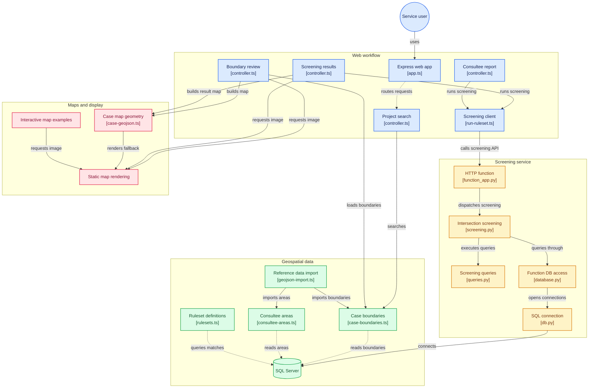

# Overview

Identify consultees finds who must be consulted about a Nationally Significant Infrastructure Project (NSIP). A case officer picks a project, the service screens its site boundary against the areas every potential consultee covers (councils, parishes, hospitals, national parks and so on) using a **ruleset**, and lists the consultees with why each was identified. Today this is done by hand in a separate GIS tool ([the manual process](../docs/gis-shapefile-upload-and-report.md)).

## How it fits together

```
Browser ──HTTPS──▶ Azure Front Door ──▶ manage web app (App Service, Node) ◀── Entra ID sign-in
                                          │  ├─ Azure SQL: cases, map geometry (Prisma)
                                          │  ├─ Blob storage: reference data GeoJSON (admin import)
                                          │  └─ Redis (sessions), Key Vault (secrets)
                                          └─ POST /api/run-ruleset (x-api-key) ──▶ Python Function App
                                                                                     └─ spatial SQL ──▶ Azure SQL
```

The same flow at code level — which files handle each step (diagram nodes link to the source on GitHub):



<details>
<summary>Static image of the diagram, for viewers that don't render mermaid (such as Confluence)</summary>


</details>

| Path                   | What it is                                                                                                                                       |
| ---------------------- | ------------------------------------------------------------------------------------------------------------------------------------------------ |
| `apps/manage`          | The web app: Express, Nunjucks, GOV.UK Frontend, vanilla JS. Search, project map, report journey, admin data import. See [Web app](./web-app.md) |
| `apps/function-python` | The Python Function App. `run-ruleset` runs the screening as spatial SQL. See [Screening service](./screening-service.md)                        |
| `packages/database`    | Prisma schema and migrations, geospatial SQL for the web app, ruleset definitions (CSV), seed and import tooling                                 |
| `infrastructure`       | Terraform for Dev, Test, Training and Prod. See [Deployment](./deployment.md)                                                                    |

The main journey is **database-backed**: there are no fixtures. Locally the database holds the sample dataset seeded by `npm start`. An empty or unreachable database means empty results, and the pages say so rather than failing.

## What's built

- Search projects, open a project's map of consultees, change the ruleset or boundary file
- Screening in the Python function: `intersection` and `bordering` conditions, plus a general nearby search
- Every consultee carries its reasons, shown as **Why identified**
- Report journey: check counts per category, remove or add consultees (typed names matched to the nearby ones), generate, see the report's consultees and download them as an Excel workbook with a PDF of each category's map
- Interactive Defra map with a server-rendered static fallback
- Admin upload and import that replaces each reference-data table
- Entra sign-in, Front Door, Key Vault, Redis sessions, Application Insights

## Not built yet

- The report workbook's **Other Cases** tab
- Uploading a project's shapefile: the journey uses case boundaries already in the database
- The remaining rulesets: three of the expected eight exist (see [Screening engine](./data/screening-engine.md#rulesets))
- Redeveloped data processing (new ingest, ids and schema), being built separately
- Keeping case boundaries in step with CBOS automatically: today an admin imports them by hand (`/admin/import-from-cbos`); a Service Bus subscription is the next step

## Decisions

| Decision                                                                             | Why                                                                                        |
| ------------------------------------------------------------------------------------ | ------------------------------------------------------------------------------------------ |
| Server-rendered GOV.UK Frontend and Nunjucks, no SPA or custom design system         | GDS alignment, accessible defaults, PINS core patterns                                     |
| Maps are progressive enhancement: interactive when JS works, a static image when not | The journey must work without JavaScript                                                   |
| Screening runs in the Python function, as SQL `GEOGRAPHY` queries                    | The geo logic lives with the Python tooling. One implementation, no Node fallback          |
| The web app sends the ruleset's conditions with each run                             | The definitions have one home, which the report pages also read                            |
| Selections (removed and added consultees) live in the URL                            | No server-side state; counts and lists always agree                                        |
| Node 24 and npm 11, major versions pinned                                            | Same as Azure Pipelines; minor and patch float                                             |
| Express `trust proxy` is a hop count (`1`), and the origin stays HTTP/1.1            | Secure cookies and safe rate limiting behind Front Door, which terminates HTTP/2 and later |

## Open questions

| Question                                                                      | Today                                                              |
| ----------------------------------------------------------------------------- | ------------------------------------------------------------------ |
| Where do the other rulesets come from?                                        | Three, from the rulesets workbook                                  |
| Should the report include every consultee within the nearby radius?           | It does: they're listed with the reason "Within 20km of the site"  |
| Which formats should project upload accept, and who owns the stored boundary? | No upload; existing case boundaries only                           |
| When does the full reference dataset replace the sample in Test and Training? | Dev has the full dataset; Test and Training have the seeded sample |
| Are the screening margins right?                                              | See [Screening issues](./data/screening-issues.md)                 |

## Before go-live

- [ ] Add the visual regression tests to the PR pipeline once screens are final, with Linux baselines (see [Testing](./testing.md))
- [ ] Remove the components showcase (`/components/*`, including the interactive map examples). The dev pages only mount when `devPagesEnabled` is on
- [ ] Get sign-off for the consultee category map colours (interim, see [Maps](./maps.md))
- [ ] Size the Prod database for screening and load-test it (see [Screening issues](./data/screening-issues.md))
